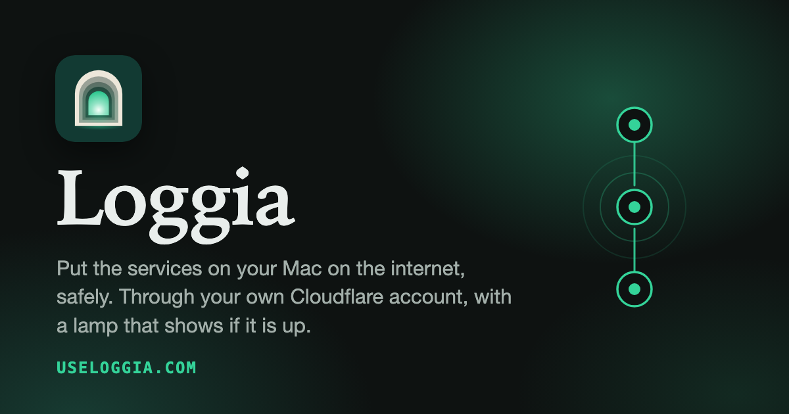

<div align="center">

# Loggia website

Source of the Loggia website (useloggia.com): a static site in nine languages, deployed on Cloudflare Workers.

[](https://github.com/ydongy/loggia-website/actions/workflows/ci.yml)
[](LICENSE)
[](https://useloggia.com)

**English** · [简体中文](README.zh-CN.md)

</div>

<p align="center"></p>

## Features

- Nine languages: English, Simplified and Traditional Chinese, Japanese, Korean, French, German, Spanish and Portuguese; English is the reference.
- Static generation: `i18n/*.json` and `changelog.json` go through `scripts/build.py` into `public/`. Python standard library only, no framework, no install step.
- One address per page, no redirects or aliases; a first-time visitor is sent to a supported browser language.
- Deployed as Cloudflare Workers static assets (`wrangler.jsonc`), with the Content-Security-Policy in `public/_headers`.
- No cookies and no third-party code except Cloudflare Web Analytics; checks for i18n consistency, links and anchors, CSP, and legal facts run in CI.

## Requirements

- Python 3 (standard library only).
- Optional: Node.js for `npx wrangler dev` and deploys.

## Quick start

```bash
git clone https://github.com/ydongy/loggia-website.git
cd loggia-website
python3 scripts/sitekit/preview.py      # serves public/ locally and prints the address
```

`preview.py` serves extensionless paths such as `/zh/privacy` the way production does; `python3 -m http.server` does not. `npx wrangler dev` works as well.

## Usage

### Pages

| Page | Address | Source of its copy |
|---|---|---|
| Home (with `#download` and `#pricing`) | `/` | `home` in `i18n/<code>.json` |
| FAQ | `/faq` | `faq` |
| Changelog | `/changelog` | `changelog.json` |
| Privacy Policy | `/privacy` | `privacy` |
| Terms of Service | `/terms` | `terms` |
| Refund Policy | `/refund` | `refund` |
| Support | `/support` | `support` |
| Not found | `/404` | generated |

Other languages add a prefix (`/zh/faq`, `/zh-hant/terms`, ...). Details: [docs/content.md](docs/content.md).

### Languages

`en`, `zh`, `zh-hant`, `ja`, `ko`, `fr`, `de`, `es`, `pt`. To add one (open an issue first): add it to `i18n/languages.json`, translate `i18n/en.json` into `i18n/<code>.json` with the same structure and JSON formatting and five pairs of screenshots `public/img/app-<code>-<scene>-{light,dark}.webp` ([docs/adr/0006-screenshot-carousel.md](docs/adr/0006-screenshot-carousel.md)), then rebuild and run the checks below.

### Content sources

- Facts (price, plan limits, refund window and so on) come from the product's own facts list; the Facts table in [docs/content.md](docs/content.md) mirrors them and `scripts/check_facts.py` verifies every language against it.
- `changelog.json` is updated automatically: Loggia's release process opens a pull request against this repository for each release. Do not edit it by hand, and keep its path and format ([docs/contracts.md](docs/contracts.md)).
- Terms of Service follow the app's license text; Privacy and Refund policies are written here.

### App dependencies

The app links to `/privacy`, `/terms`, `/refund`, `/changelog` and `/#pricing`, and these addresses stay stable. The download button reads `https://dl.useloggia.com/latest.json` (version and checksum, written by the app's release tooling). If that address changes, update `connect-src` in `public/_headers` too.

## Development

Edit `i18n/*.json`, `changelog.json` (via the release tooling), `public/style.css` or `scripts/build.py`; never the generated HTML or `public/lang.js`. Then run, in this order (the same as [CI](.github/workflows/ci.yml)):

```bash
python3 scripts/sitekit/check_i18n.py   # every language matches English: structure, tags, links, placeholders
python3 scripts/build.py                # regenerate public/
git diff --exit-code -- public/         # the committed output matches the sources
python3 scripts/sitekit/check_site.py   # pages, links, anchors, Content-Security-Policy
python3 scripts/check_facts.py          # the Facts table in docs/content.md against every language
```

Commit the regenerated `public/` together with the source change that produces it; CI fails with "public/ is stale" otherwise.
- Share image: `public/og.png` (1200x630) is rendered from `design/og.html` by `scripts/export-og.sh` (headless Chrome); render it again when the icon or the tagline changes.

```
.
├── i18n/                    # copy per language (en.json is the reference), languages.json
├── changelog.json           # release history, written by release tooling
├── design/                  # source of the share image (og.html)
├── scripts/
│   ├── build.py             # generator and site settings
│   ├── check_facts.py       # legal facts check
│   └── sitekit/             # vendored page generator, checks and preview server
├── public/                  # generated site, committed
├── docs/                    # content, design, contracts, ADRs
└── wrangler.jsonc           # Cloudflare Workers static assets config
```

`scripts/sitekit/` is a vendored copy of ydongy's sitekit; change it upstream, not here ([ADR](docs/adr/0005-vendored-sitekit.md)). More: [docs/design.md](docs/design.md), [docs/contracts.md](docs/contracts.md), [AGENTS.md](AGENTS.md).

### Deployment

Cloudflare Workers Builds deploys `main` automatically: project `loggia`, empty build command, deploy command `npx wrangler deploy`, which serves `public/` as configured in `wrangler.jsonc`. There is no build at deploy time, so `public/` **must be committed**. The custom domain is bound in the Cloudflare dashboard, not in the config; `workers_dev` and `preview_urls` are off on purpose.

Operational notes (domain binding, build checks, headers, mail routing): [docs/deployment.md](docs/deployment.md).

## Contributing

See [CONTRIBUTING.md](CONTRIBUTING.md). Open an issue before larger changes. Use [Conventional Commits](https://www.conventionalcommits.org/) for commit messages and PR titles.

## Security

Please report vulnerabilities privately via GitHub Security: [Report a vulnerability](https://github.com/ydongy/loggia-website/security/advisories/new). Do not open a public issue.

## License

The source code in this repository is released under the [MIT License](LICENSE).

The Loggia name, logo and icon, and the website copy (text and translations), are copyright (c) 2026 ydongy and are **not** covered by the MIT License. Loggia is a closed-source product (only this website is open); the name and icon may not be used to suggest endorsement or to name a derived work.
